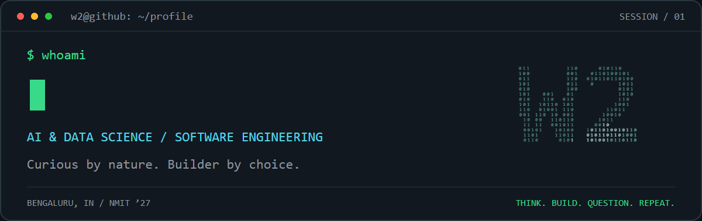
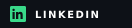
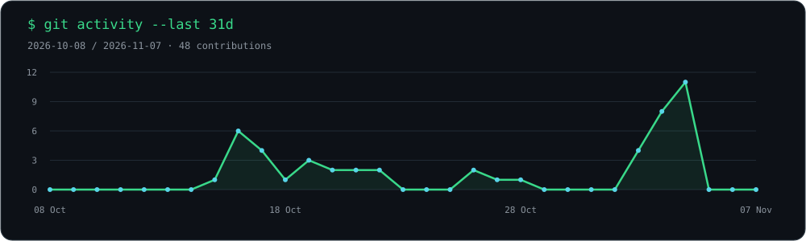

<!-- Upload this file to W2Viswajit/W2Viswajit and keep assets/ beside it. -->
<p align="center">
  
</p>

<p align="center">
  <a href="https://viswajit-w2.vercel.app/"></a>
  <a href="https://www.linkedin.com/in/viswajit-ramesh-kumar"></a>
  <a href="mailto:viswajitw2@gmail.com"></a>
</p>

## `01 / whoami`

I'm **Viswajit R**, an AI & Data Science undergraduate at **NMIT, Bengaluru (Class of 2027)**. I build across machine learning and software engineering: from comparing deep learning models to turning an idea into an app people can use.

```yaml
viswajit:
  focus: [applied AI, full-stack development, useful software]
  exploring: [causal inference, reinforcement learning]
  community: Technical Head @ AUGMENTIX
  mindset: "Think. Build. Question. Repeat."
```

I'm interested in **AI/ML and software engineering opportunities** where I can experiment, build, and learn with a team.

## `02 / selected_builds`

| Project | What I built / explored | Core tools |
| :--- | :--- | :--- |
| **[Prism](https://github.com/W2Viswajit/Prism-Offline-File-Converter-for-Windows)** | An offline Windows file converter for images, PDFs, and OCR. Files stay on your machine. | `Python` · `Windows` · `OCR` |
| **[Document Forgery Detection](https://github.com/W2Viswajit/Document-Forgery-Detection)** | Experiments comparing five deep learning architectures for detecting manipulated documents. | `Python` · `CNNs` · `Deep Learning` |
| **[RhythmX](https://github.com/W2Viswajit/RhytmX)** | Music discovery through audio-feature clustering and listening patterns, with a React interface and FastAPI backend. | `React` · `FastAPI` · `scikit-learn` |
| **[ReachInbox](https://github.com/W2Viswajit/ReachInbox-Project)** | A full-stack email-scheduling assignment with queued jobs, OAuth, and search. Uses Ethereal for test emails. | `TypeScript` · `PostgreSQL` · `Redis` |

<details>
<summary><b>More experiments & builds</b></summary>

- **[Few-shot handwriting generation](https://github.com/W2Viswajit/fewshot-handwriting-vae)** — exploring handwriting font generation for English and Hindi.
- **[HackSurge X](https://github.com/W2Viswajit/HackSurgeX)** — an animated hackathon event website.
- **[Browse my repositories →](https://github.com/W2Viswajit?tab=repositories)**

</details>

## `03 / research_log`

**Causal Reinforcement Learning for Algorithmic Trading** · Final-year project

Exploring how causal structure can inform sequential decisions: combining NOTEARS and Structural Causal Models with reinforcement learning, then comparing against non-causal baselines through ablation studies and statistical testing.

`Causal inference` · `Dueling Double DQN` · `Discrete SAC` · `Python`

## `04 / toolkit`

**Languages**  


**AI / ML**  


**Applications / Data**  


## `05 / beyond_the_code`

At **AUGMENTIX**, NMIT's AI & DS student club, I've led **12 junior developers across 3 incubation projects** and co-developed an **AR/VR curriculum with Madras Mindworks** used by **80+ engineering students**.

I enjoy the part of engineering that happens between people: sharing ideas, helping someone get unstuck, and building something together.

## `06 / activity_log`



### `> snake --contributions`

<picture>
  <source media="(prefers-color-scheme: dark)" srcset="https://raw.githubusercontent.com/W2Viswajit/W2Viswajit/output/github-snake-dark.svg" />
  <source media="(prefers-color-scheme: light)" srcset="https://raw.githubusercontent.com/W2Viswajit/W2Viswajit/output/github-snake.svg" />
  
</picture>

---

<p align="center">
  <b>Have an interesting problem? Let's build something.</b><br />
  <a href="mailto:viswajitw2@gmail.com">Email</a> · <a href="https://www.linkedin.com/in/viswajit-ramesh-kumar">LinkedIn</a> · <a href="https://viswajit-w2.vercel.app/">Portfolio</a>
</p>

<p align="center"><sub>curiosity.exe is still running_</sub></p>
